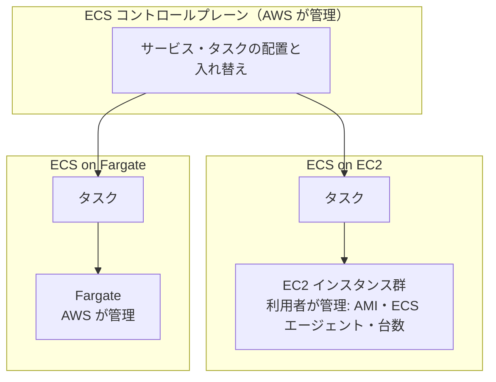

[目次へ戻る](README.md)

# 1. EC2 / ECS / Fargate / RDS / S3

## EC2（Elastic Compute Cloud）

仮想サーバーを必要な数・必要な時間だけ借りるサービス。OS から上は利用者が管理する。

**主な概念**

- **インスタンスタイプ**: CPU・メモリ・ネットワーク性能の組み合わせ。`t`（バースト型の汎用）、`m`（汎用）、`c`（計算重視）、`r`（メモリ重視）、`g` / `p`（GPU）などのファミリーがある。`m7g.large` のように「ファミリー・世代・追加属性・サイズ」で表す。末尾の `g` は Graviton（Arm）を意味する。
- **AMI（Amazon Machine Image）**: インスタンスの起動元になるイメージ。OS と初期設定済みのソフトウェアを含む。[6 章](06-cicd.md)の EC2 Image Builder で自作 AMI を量産できる。
- **EBS（Elastic Block Store）**: インスタンスにつなぐ永続的なブロックストレージ。インスタンスを停止しても残る。スナップショットで S3 にバックアップされる。gp3（汎用 SSD）が標準的な選択。
- **インスタンスストア**: ホストに直結した一時ストレージ。停止すると消える。
- **キーペア / Session Manager**: SSH 接続用の鍵。最近は SSH ポートを開けず、Systems Manager の Session Manager で接続する構成が推奨される。
- **ユーザーデータ**: 初回起動時に実行するスクリプト。
- **Elastic IP**: 固定のパブリック IPv4 アドレス。
- **Auto Scaling グループ**: 負荷や台数の指定に応じてインスタンスを増減し、故障したものを入れ替える。[4 章](04-cloudfront-alb-waf.md)の ALB と組み合わせるのが定番。

**購入オプション**

| オプション | 特徴 | 向いている用途 |
| --- | --- | --- |
| オンデマンド | 秒単位課金、契約なし | 検証、変動の読めない負荷 |
| Savings Plans / リザーブドインスタンス | 1 年または 3 年の利用を約束して割引 | 常時動く本番環境 |
| スポットインスタンス | 余剰容量を大幅割引で利用。2 分前通知で中断されうる | バッチ処理、中断に強い処理 |

## ECS（Elastic Container Service）

コンテナを動かし続けるためのオーケストレーションサービス。どのコンテナを何個動かすか、落ちたら立て直す、ロードバランサーに登録する、といった管理を AWS が担う。ECS 自体（コントロールプレーン）に料金はかからず、コンテナを動かす計算資源の分だけ払う。

**主な概念**

- **クラスター**: タスクやサービスを動かす論理的なまとまり。
- **タスク定義**: コンテナの設計図。コンテナイメージ、CPU とメモリ、ポート、環境変数、シークレット（Secrets Manager・Parameter Store から注入）、ログの出力先（CloudWatch Logs など）を書く。
- **タスク**: タスク定義から起動した、実行中のコンテナの組。
- **サービス**: 指定した数のタスクを動かし続ける仕組み。落ちたタスクを入れ替え、[4 章](04-cloudfront-alb-waf.md)の ALB のターゲットグループに自動で登録する。タスク数は CPU 使用率やリクエスト数に応じて増減できる（Service Auto Scaling）。単発の処理やバッチはサービスにせず、タスクを直接起動する。
- **デプロイ**: 既定はローリング更新（新しいタスクを少しずつ増やし、古いものを減らす）。ブルー/グリーンも選べる（[6 章](06-cicd.md)の CodeDeploy でも行える）。
- **ネットワークモード**: `awsvpc` ではタスクごとにネットワークインターフェイスが付き、タスク単位で[2 章](02-vpc.md)のセキュリティグループをかけられる。ほかに `bridge`、`host` がある。
- **IAM ロール**: タスクロール（アプリケーションが S3 などを呼ぶための権限）と、タスク実行ロール（ECS がイメージを取得し、ログを書き、シークレットを読むための権限）の 2 つを区別する。
- **ECR（Elastic Container Registry）**: コンテナイメージの置き場。ECS はここからイメージを取得するのが一般的。
- **起動タイプ / キャパシティープロバイダー**: タスクをどこで動かすか。自分の EC2 インスタンスで動かす **EC2**、サーバーを意識しない **Fargate** がある（下で比べる）。

## Fargate

コンテナ向けのサーバーレスな計算エンジン。ECS（と EKS）のタスクを動かす場所として使う。インスタンスの用意や OS の更新は要らず、タスクごとに vCPU とメモリを指定するだけで動く。

**主な概念**

- **サイズ**: タスクごとに vCPU（0.25〜16）とメモリの組み合わせを選ぶ。
- **課金**: タスクが要求した vCPU・メモリ・ストレージに対して秒単位（最低 1 分）。
- **一時ストレージ**: 既定 20 GiB、最大 200 GiB。タスクが止まると消える。
- **ネットワーク**: `awsvpc` モードのみ。タスクはサブネットに置かれ、タスクごとにセキュリティグループを付ける。
- **Fargate Spot**: 余剰容量を割引で使う。2 分前の通知で中断されうるので、中断に強い処理に使う。
- **ホストには入れない**: SSH はできない。調査でコンテナの中に入るときは ECS Exec を使う。
- **アーキテクチャ**: x86_64 と Arm（Graviton）を選べる。GPU は使えない。

## ECS on EC2 と ECS on Fargate

ECS は「コンテナをどう動かすか」を管理し、EC2 と Fargate は「コンテナをどこで動かすか」を受け持つ。どちらを選んでも、タスク定義やサービスの書き方はほぼ同じで、違うのは下の層を誰が管理するか。

| 観点 | ECS on EC2 | ECS on Fargate |
| --- | --- | --- |
| 利用者が管理するもの | タスクに加えて EC2 インスタンス（ECS 最適化 AMI の更新、ECS エージェント、台数） | タスクだけ |
| スケール | タスク数とインスタンス数の 2 段。キャパシティープロバイダーで Auto Scaling グループを連動させる | タスク数だけ |
| 課金の単位 | EC2 インスタンス。タスクで使い切れない空きの分も払う | タスクが要求した vCPU・メモリ |
| 割引 | Savings Plans、リザーブドインスタンス、スポットインスタンス | Compute Savings Plans、Fargate Spot |
| ネットワークモード | `awsvpc`、`bridge`、`host` | `awsvpc` のみ |
| GPU・特定のインスタンスタイプ | 使える | 使えない |
| ホストへのアクセス | できる（デーモンの常駐、カーネル設定など） | できない |
| 向いている場面 | 常に大量のタスクを動かし、インスタンスを高い使用率で使い切れる。GPU やホストの調整が必要 | 運用の手間を減らしたい。負荷の変動が大きい。小〜中規模 |

迷ったら Fargate から始め、費用やインスタンスの要件で困ったときに EC2 を検討する、という順が一般的。

## RDS（Relational Database Service）

マネージドなリレーショナルデータベース。インストール、パッチ適用、バックアップ、フェイルオーバーを AWS が担う。OS には入れない。

**エンジン**: MySQL、PostgreSQL、MariaDB、Oracle、SQL Server、Db2。互換性を保ちつつ性能と可用性を高めた独自エンジンとして Amazon Aurora（MySQL 互換 / PostgreSQL 互換）がある。

**主な概念**

- **マルチ AZ 配置**: 別のアベイラビリティゾーン（AZ）に同期レプリカ（スタンバイ）を置き、障害時に自動で切り替える。可用性のための仕組み。
- **リードレプリカ**: 非同期で複製した読み取り専用のコピー。読み込み負荷の分散のための仕組み。
- **自動バックアップ**: 保持期間（最大 35 日）内の任意の時点に復元できる（ポイントインタイムリカバリ）。手動スナップショットは削除するまで残る。
- **DB サブネットグループ**: RDS を配置するサブネットの組。[2 章](02-vpc.md)のプライベートサブネットを複数 AZ 分指定する。
- **パラメータグループ**: DB エンジンの設定値の集まり。
- **メンテナンスウィンドウ**: パッチ適用などを行う時間帯。

## S3（Simple Storage Service）

オブジェクトストレージ。ファイルを「バケット」に「キー（名前）」付きの「オブジェクト」として置く。容量の上限を気にせず使える。

**主な概念**

- **バケット**: オブジェクトの入れ物。名前はグローバルで一意。リージョンを指定して作る。
- **オブジェクト**: 1 つあたり最大 5 TB。
- **耐久性と整合性**: 99.999999999%（イレブンナイン）の耐久性を想定した設計。書き込み直後の読み込みでも最新の内容が返る（強い整合性）。
- **ストレージクラス**: アクセス頻度に応じて料金を下げる。

| クラス | 用途 |
| --- | --- |
| S3 Standard | 頻繁にアクセスするデータ |
| S3 Intelligent-Tiering | アクセス傾向が読めないデータ。自動で階層を移す |
| S3 Standard-IA / One Zone-IA | アクセスはまれだが、すぐ取り出したいデータ |
| S3 Glacier Instant Retrieval | アーカイブだが、ミリ秒で取り出したいデータ |
| S3 Glacier Flexible Retrieval / Deep Archive | 長期保管。取り出しに数分〜数十時間かかる |

- **ライフサイクルルール**: 経過日数に応じてクラスを移したり、削除したりする。
- **バージョニング**: 上書き・削除の前の版を残す。
- **アクセス制御**: 既定で非公開。ブロックパブリックアクセスで公開を防ぎ、バケットポリシー（[5 章](05-cloudformation-iam.md)のリソースベースポリシー）で許可を与える。
- **暗号化**: 新しいオブジェクトは既定でサーバー側暗号化（SSE-S3）される。KMS の鍵を使う SSE-KMS も選べる。
- **用途**: 静的ファイルの配信元（[4 章](04-cloudfront-alb-waf.md)の CloudFront と組み合わせる）、ログ・バックアップの保管、データレイク、[6 章](06-cicd.md)のビルド成果物の置き場。

## 使い分け

| 観点 | EC2 | ECS on Fargate | RDS | S3 |
| --- | --- | --- | --- | --- |
| 扱うもの | 計算処理（アプリケーション） | 計算処理（コンテナ） | 構造化データ（テーブル・SQL） | ファイル（オブジェクト） |
| 管理範囲 | OS から上は利用者 | コンテナイメージとタスク定義のみ | DB の設定とデータのみ | データとアクセス権のみ |
| 配置 | VPC 内のサブネット | VPC 内のサブネット | VPC 内のサブネット | VPC の外（リージョンのサービス） |
| スケール | インスタンスの台数・タイプを変える | タスク数を変える | インスタンスクラス変更、リードレプリカ | 自動 |

ECS on EC2 の管理範囲とスケールは、EC2 と ECS on Fargate を足したものになる。
