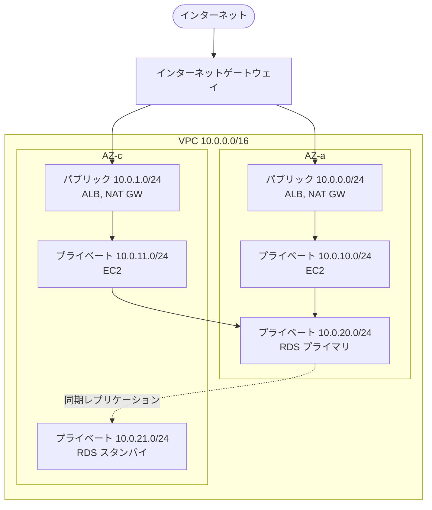

[目次へ戻る](README.md)

# 2. VPC / サブネット / セキュリティグループ

## VPC（Virtual Private Cloud）

AWS 上に作る、利用者専用の論理的に分離されたネットワーク。1 つのリージョンの中に作り、そのリージョンのすべての AZ にまたがる。

- **CIDR ブロック**: VPC が使う IP アドレスの範囲。`/16`（65,536 個）から `/28`（16 個）の間で指定する。例: `10.0.0.0/16`。オンプレミスや他の VPC とつなぐ予定があるなら、重ならない範囲を選ぶ。
- **インターネットゲートウェイ（IGW）**: VPC とインターネットをつなぐ出入口。VPC に 1 つ付ける。
- **NAT ゲートウェイ**: プライベートサブネットからインターネットへの「外向きだけ」の通信を中継する。パブリックサブネットに置く。AZ 単位のリソースなので、可用性を求めるなら AZ ごとに置く。時間と通信量で課金されるため、費用が目立ちやすい。
- **ルートテーブル**: サブネットから出る通信の行き先を決める表。サブネットごとに 1 つ関連付ける。
- **VPC エンドポイント**: インターネットを通らずに AWS のサービスへ接続する。S3 と DynamoDB 向けのゲートウェイ型（無料）と、それ以外向けのインターフェイス型（PrivateLink、有料）がある。
- **他のネットワークとの接続**: VPC ピアリング（1 対 1）、Transit Gateway（多数の VPC やオンプレミスを集約）、Site-to-Site VPN、Direct Connect。

## サブネット

VPC の CIDR を分割した区画。1 つのサブネットは 1 つの AZ に属する。各サブネットの先頭 4 個と末尾 1 個の IP アドレスは AWS が予約しているため使えない。

| 種類 | ルートテーブルの設定 | 置くもの |
| --- | --- | --- |
| パブリックサブネット | `0.0.0.0/0` の行き先が IGW | ALB、NAT ゲートウェイ、踏み台 |
| プライベートサブネット | `0.0.0.0/0` の行き先が NAT ゲートウェイ（またはなし） | EC2（アプリ）、RDS、VPC 内の Lambda |

「パブリック」かどうかは名前ではなく、ルートテーブルに IGW への経路があるかで決まる。

## セキュリティグループ

インスタンス（正確にはネットワークインターフェイス）単位の仮想ファイアウォール。

- **許可ルールのみ**を書く。書いていない通信はすべて拒否される。
- **ステートフル**: 許可した通信の戻りの通信は、ルールがなくても自動で通る。
- 送信元として IP アドレス範囲のほか、**別のセキュリティグループを指定できる**。「ALB の SG からの 80 番だけ EC2 に通す」「アプリの SG からの 3306 番だけ RDS に通す」と書けば、IP アドレスが変わっても設定を直さずに済む。

## ネットワーク ACL との違い

サブネット単位のファイアウォールとしてネットワーク ACL もある。通常はセキュリティグループを主に使い、ネットワーク ACL は既定（全許可）のまま、または特定のアドレスを拒否する補助に使う。

| 観点 | セキュリティグループ | ネットワーク ACL |
| --- | --- | --- |
| 適用単位 | インスタンス（ENI） | サブネット |
| ルール | 許可のみ | 許可と拒否 |
| 状態 | ステートフル（戻りは自動許可） | ステートレス（戻りも明示的に許可が必要） |
| 評価 | すべてのルールを評価 | 番号の小さい順に評価し、最初に一致したもので決定 |

## 典型的な 3 層構成

セキュリティグループの連鎖の例:

| SG | インバウンドの許可 |
| --- | --- |
| ALB 用 | `0.0.0.0/0` から 443 |
| アプリ用 | ALB 用 SG から 8080 |
| DB 用 | アプリ用 SG から 3306（MySQL）または 5432（PostgreSQL） |
