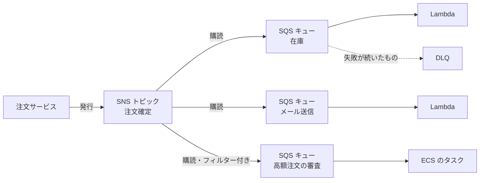
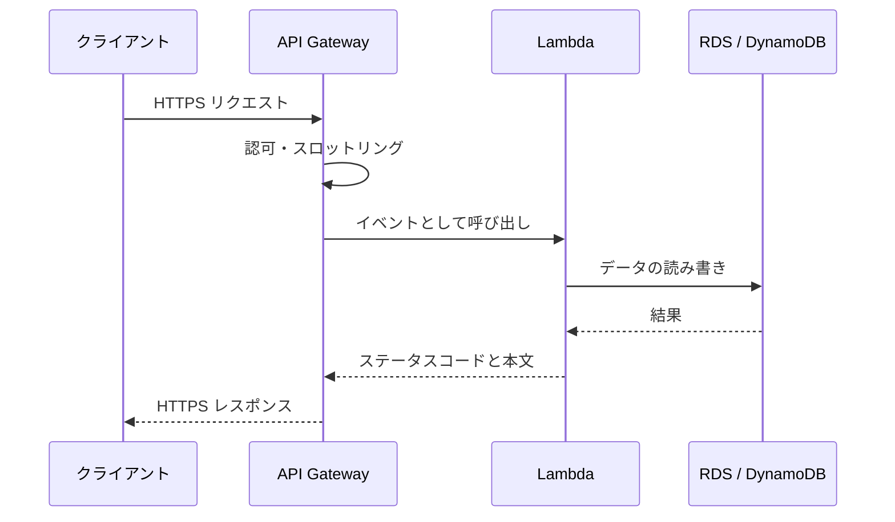
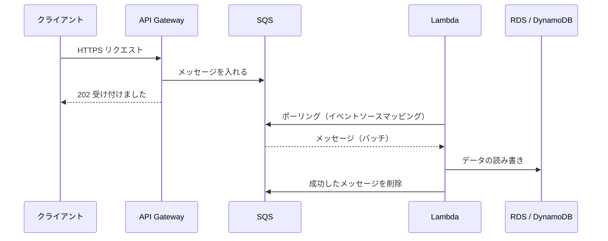

[目次へ戻る](README.md)

# 3. Lambda / API Gateway / SNS / SQS

この章は、サーバーを持たずに処理を動かす仕組み（Lambda・API Gateway）と、処理と処理の間をメッセージでつなぐ仕組み（SNS・SQS）を扱う。後者を挟むと、受け付けと処理を切り離せるので、負荷の急増や処理側の障害に強くなる。

## Lambda

サーバーを用意せずにコードを実行するサービス。イベントが来たときだけ関数が動き、実行時間とリクエスト数で課金される。

**主な概念**

- **ランタイム**: Node.js、Python、Java、.NET、Ruby などの公式ランタイムのほか、カスタムランタイムやコンテナイメージ（最大 10 GB）でも動かせる。
- **メモリ**: 128 MB〜10,240 MB で指定する。CPU はメモリに比例して割り当てられる。
- **タイムアウト**: 最大 15 分。長時間の処理には向かない（その場合は ECS や Step Functions を検討する）。
- **一時領域**: `/tmp` を 512 MB〜10 GB 使える。実行環境が再利用されれば残るが、当てにしない。
- **トリガー**: API Gateway、S3 のイベント、[SNS](#sns)、[SQS](#sqs)、EventBridge（スケジュール実行含む）、DynamoDB Streams など。
- **コールドスタート**: 新しい実行環境を作るときの初期化の遅延。プロビジョニング済み同時実行や SnapStart で抑えられる。
- **同時実行数**: アカウント・リージョンごとに上限がある（既定 1,000）。予約同時実行で関数ごとに確保・制限できる。
- **実行ロール**: 関数が他の AWS サービスを呼ぶための IAM ロール（[5 章](05-cloudformation-iam.md)）。
- **VPC アクセス**: 関数を VPC のプライベートサブネットに接続すれば RDS などに届く。インターネットへ出るには NAT ゲートウェイが要る。RDS に多数の接続を張る場合は RDS Proxy を挟む。
- **レイヤー**: 共通ライブラリを複数の関数で共有する仕組み。

## API Gateway

HTTP の API を公開する入口のマネージドサービス。認証、流量制限、ステージ管理を担い、裏側の Lambda や HTTP エンドポイントにリクエストを渡す。

| 種類 | 特徴 |
| --- | --- |
| REST API | 機能が多い。API キーと使用量プラン、リクエストの検証・変換、キャッシュ、AWS WAF 連携（[4 章](04-cloudfront-alb-waf.md
| HTTP API | 機能を絞った分、安くて低遅延。JWT オーソライザーを標準で持つ |
| WebSocket API | 双方向の常時接続（チャット、通知など） |

**主な概念**

- **統合**: リクエストの渡し先。Lambda プロキシ統合ではリクエスト全体を Lambda に渡し、Lambda の戻り値をそのままレスポンスにする。
- **ステージ**: `dev`、`prod` など、同じ API の公開単位。
- **認可**: IAM 認可、Amazon Cognito ユーザープール、Lambda オーソライザー、JWT（HTTP API）。
- **スロットリング**: 秒間リクエスト数の上限を設けてバックエンドを守る。
- **統合タイムアウト**: 既定で 29 秒。長い処理は非同期化する。
- **カスタムドメイン**: ACM の証明書を使って独自ドメインで公開する。

## SQS

Amazon SQS（Simple Queue Service）は、メッセージを一時的に預かるキュー。送る側はキューに入れたら終わりで、受け取る側は自分の都合のよいときにキューから取り出して（ポーリングして）処理する。1 つのメッセージを処理するのは、受け取る側のどれか 1 つ。

**キューの種類**

| 種類 | 順序 | 重複 | スループット |
| --- | --- | --- | --- |
| 標準キュー | おおむね送った順。入れ替わることがある | まれに同じメッセージが 2 回以上届く（少なくとも 1 回の配信） | ほぼ無制限 |
| FIFO キュー | メッセージグループ ID ごとに送った順を守る | 5 分以内の重複は取り除かれる（1 回だけの処理） | API 操作ごとに秒間 300 件（10 件ずつのバッチで 3,000 件）。高スループットモードで引き上げられる |

標準キューでは重複と順序の入れ替わりが起こりうるので、受け取る側の処理は、同じメッセージを 2 回処理しても結果が変わらない（冪等な）作りにしておく。FIFO キューの名前は `.fifo` で終える。

**主な概念**

- **メッセージ**: 最大 1 MiB。それより大きいデータは S3 に置き、その場所をメッセージで渡す（拡張クライアントライブラリでもできる）。
- **保持期間**: 既定 4 日、1 分〜14 日。取り出されずに期間が過ぎたメッセージは消える。
- **可視性タイムアウト**: 取り出されたメッセージは、この時間（既定 30 秒、最大 12 時間）ほかの受け手から見えなくなる。処理し終えたら受け手が削除する。削除されないまま時間が過ぎると、もう一度取り出せるようになる。処理にかかる時間より長く設定する。
- **ロングポーリング**: メッセージが来るまで最大 20 秒待ってから返す。空の応答と、その分の料金を減らせる。
- **デッドレターキュー（DLQ）**: 指定した回数（`maxReceiveCount`）受け取られても削除されないメッセージを、別のキューに移す。処理できないメッセージが延々と再処理されるのを防ぎ、あとで調べられる。原因を直したら元のキューに戻せる（再処理）。
- **遅延**: キューに入れてから見えるようになるまでの時間。最大 15 分。

**Lambda との組み合わせ**

イベントソースマッピングを設定すると、Lambda がキューをポーリングし、メッセージをまとめて（バッチで）関数に渡す。関数が正常に終われば、Lambda がメッセージを削除する。

- キューの可視性タイムアウトは、関数のタイムアウトの 6 倍以上にするのが AWS の推奨。
- バッチの一部だけが失敗したときは、部分的なバッチレスポンス（`ReportBatchItemFailures`）で失敗したメッセージだけを返し、成功したものの再処理を避ける。
- 最大同時実行数を指定すると、後ろの RDS などに押し寄せる負荷を抑えられる。

[1 章](01-ec2-ecs-rds-s3.md)の ECS のタスクや EC2 のアプリが受け手になることもある。その場合は、キューに溜まったメッセージの数に応じてタスク数・台数を増減させる。

## SNS

Amazon SNS（Simple Notification Service）は、発行・購読（pub/sub）型のメッセージ配信サービス。送る側がトピックにメッセージを発行すると、そのトピックを購読しているすべての受け手に、SNS が同じメッセージを押し出す（プッシュする）。

**主な概念**

- **トピック**: メッセージの宛先になる名前付きの窓口。標準トピックと FIFO トピックがある。FIFO トピックは順序を守り、重複を取り除く。受け手は SQS キュー。
- **サブスクリプション**: トピックと受け手の結び付き。受け手として次のものを指定できる。

| 受け手 | 主な使い道 |
| --- | --- |
| SQS | メッセージを確実に溜めてから処理する |
| Lambda | 届いたらすぐに処理する |
| HTTP / HTTPS | 外部のシステムに通知する |
| メール / SMS / モバイルプッシュ | 人に知らせる（障害通知など） |
| Data Firehose | S3 などに蓄積する |

- **メッセージフィルタリング**: サブスクリプションごとにフィルターポリシーを書くと、条件に合うメッセージだけをその受け手に届ける。例: `type` が `order.created` のものだけを在庫処理に送る。
- **メッセージサイズ**: 既定 256 KiB。トピックの `MaximumMessageSize` で 1 MiB まで引き上げられる。
- **配信の再試行**: 受け手に届かないときは再試行する。それでも届かないメッセージは、サブスクリプションに付けた DLQ（SQS キュー）に移せる。SNS 自体はメッセージを保持しないので、DLQ がなければ失われる（FIFO トピックだけは、アーカイブしておいて再送できる）。
- **アクセスポリシー**: トピックに付けるリソースベースポリシー（[5 章](05-cloudformation-iam.md)）。S3 のイベントや CloudWatch アラームから発行させるときは、そのサービスに発行を許可する。

**よくある使い方**: CloudWatch アラーム → SNS → メールや Slack への通知。S3 へのファイル到着 → SNS → 複数の処理への配布。

## SNS と SQS の違い

| 観点 | SNS | SQS |
| --- | --- | --- |
| 方式 | プッシュ（SNS が受け手に届ける） | プル（受け手が取りに来る） |
| 受け手の数 | 購読者全員に同じメッセージを届ける（1 対多） | 1 つのメッセージは受け手のどれか 1 つが処理する（1 対 1） |
| メッセージの保持 | しない（届かなければ再試行、DLQ） | 最大 14 日 |
| 受け手が止まっているとき | 再試行のあと DLQ へ、なければ失われる | キューに溜まり、受け手が戻れば処理される |
| 向いていること | 1 つの出来事を複数の処理や人に知らせる | 処理を後回しにする、負荷の山をならす、処理側の障害に耐える |

両方を組み合わせる「ファンアウト」が定番。SNS で複数の SQS キューに配り、それぞれのキューを別々の処理が自分のペースで受け取る。

1 つの処理が止まっても、ほかの処理や注文サービスには影響しない。止まっていた処理のメッセージはキューに残り、復旧後に処理される。

ルールでの振り分けや、AWS のサービス・SaaS からのイベントを多く扱うなら、Amazon EventBridge も選択肢になる。

## 組み合わせ方

**同期の API**: 処理の結果をその場で返す。

EC2 で API サーバーを常時動かす構成と比べると、アクセスが少ないときの費用が小さく、OS の管理も要らない。一方で、実行時間の上限、コールドスタート、DB 接続数の管理に気を配る必要がある。

**非同期の API**: 受け付けだけをすぐ返し、処理は後で行う。統合タイムアウト（29 秒）に収まらない処理や、アクセスが急に集中する処理に向く。API Gateway は Lambda を挟まずに、直接 SQS にメッセージを入れられる。

処理の結果をクライアントに知らせる必要があるなら、状態を DB に書いてクライアントに問い合わせてもらうか、SNS や WebSocket API で通知する。
