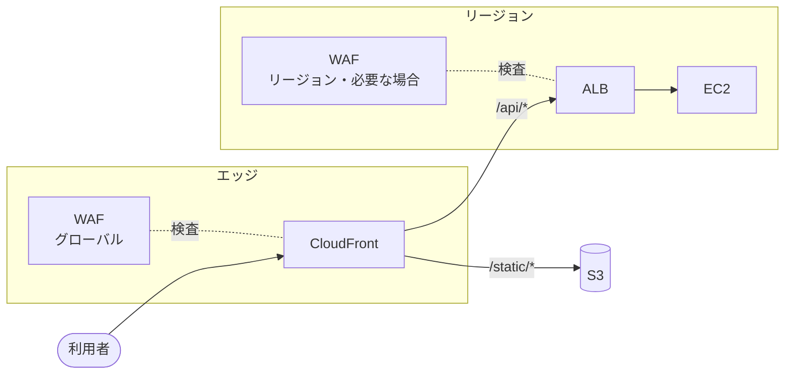

[目次へ戻る](README.md)

# 4. CloudFront / ALB / WAF

## CloudFront

世界中のエッジロケーションからコンテンツを配信する CDN。利用者に近い場所でキャッシュを返すことで、表示を速くし、オリジン（元のサーバー）の負荷を下げる。

**主な概念**

- **ディストリビューション**: CloudFront の設定の単位。`xxxx.cloudfront.net` のドメインが割り当てられる。
- **オリジン**: コンテンツの取得元。S3 バケット、ALB、API Gateway、任意の HTTP サーバー。
- **ビヘイビア**: パスごとのルール。例: `/static/*` は S3 から長くキャッシュ、`/api/*` は ALB に転送してキャッシュしない。
- **キャッシュポリシー / オリジンリクエストポリシー**: キャッシュのキー（どのヘッダー・クエリ・Cookie で区別するか）と TTL、オリジンに渡す情報を決める。
- **OAC（Origin Access Control）**: S3 バケットを非公開のまま、CloudFront 経由でのみ読めるようにする。
- **証明書**: 独自ドメインの HTTPS には ACM の証明書を使う。CloudFront 用の証明書は **バージニア北部（us-east-1）** で発行する必要がある。
- **キャッシュの無効化（Invalidation）**: 古いキャッシュを消す。ファイル名にハッシュを付けて無効化自体を減らすのが一般的。
- **エッジでの処理**: CloudFront Functions（軽量なヘッダー操作・リダイレクト）と Lambda@Edge（より重い処理）。
- **保護**: DDoS 対策の AWS Shield Standard が自動で付く。アプリケーションへの攻撃は、下の [WAF](#waf) を関連付けて防ぐ。

## ALB（Application Load Balancer）

HTTP / HTTPS（レイヤー 7）のロードバランサー。受けたリクエストを、内容に応じて複数のターゲットに振り分ける。Elastic Load Balancing（ELB）の一種。

**主な概念**

- **リスナー**: 待ち受けるプロトコルとポート（例: HTTPS:443）。HTTPS の終端（証明書は ACM）もここで行う。
- **リスナールール**: パス（`/api/*`）、ホスト名（`admin.example.com`）、ヘッダーなどの条件で振り分け先を決める。固定レスポンスやリダイレクトも返せる。
- **ターゲットグループ**: 振り分け先の集まり。EC2 インスタンス、IP アドレス（[1 章](01-ec2-ecs-rds-s3.md)の ECS の `awsvpc` タスクなど）、Lambda 関数を登録できる。
- **ヘルスチェック**: ターゲットに定期的にリクエストを送り、異常なものには振り分けない。
- **配置**: 2 つ以上の AZ のサブネットに置く。インターネット向けならパブリックサブネット、内部向けならプライベートサブネット。
- **Auto Scaling との連携**: Auto Scaling グループをターゲットグループに結び付けると、増減したインスタンスが自動で登録・解除される。
- **スティッキーセッション**: 同じ利用者を同じターゲットに送り続ける。

**ELB の種類**

| 種類 | 層 | 用途 |
| --- | --- | --- |
| ALB | L7（HTTP/HTTPS） | Web アプリ、API、パスやホストでの振り分け |
| NLB | L4（TCP/UDP/TLS） | 高スループット・低遅延、固定 IP が必要な場合 |
| GWLB | L3 | ファイアウォールなどのネットワーク機器を挟む |

## WAF

AWS WAF は、HTTP / HTTPS のリクエストの中身（IP アドレス、ヘッダー、URI、クエリ、本文など）を調べ、SQL インジェクションやクロスサイトスクリプティング、不正なボット、過剰なアクセスを止める Web アプリケーションファイアウォール。サーバーに入れるものではなく、CloudFront や ALB などの入口のサービスに関連付けて使う。

[2 章](02-vpc.md)のセキュリティグループが IP アドレスとポートで通信を絞るのに対し、WAF はリクエストの内容で判断する。

**主な概念**

- **Web ACL（保護パック）**: ルールをまとめた設定の単位。これを保護したいリソースに関連付ける。コンソールでは「protection pack (web ACL)」と表示される。
- **ルールとアクション**: 条件に一致したリクエストを、許可（Allow）・拒否（Block）・記録のみ（Count）、または CAPTCHA や Challenge（ブラウザかどうかの確認）にかける。
- **デフォルトアクション**: どのルールにも一致しなかったリクエストを許可するか拒否するか。
- **マネージドルールグループ**: AWS や AWS Marketplace の事業者が作って更新し続けるルールの集まり。AWS のものでは、OWASP Top 10 を中心にした Core rule set、既知の不正な入力、SQL データベース向け、IP 評価リストなどが無料で使える。Bot Control とアカウント乗っ取り対策は追加料金がかかる。
- **自前のルール**: IP セット（許可・拒否の一覧）、国・地域での判定、文字列・正規表現の一致、サイズの制限など。
- **レートベースルール**: 同じ IP アドレスなどからのリクエストが一定時間内に上限を超えたら止める。ログイン画面への総当たりや過剰なアクセスへの対策。
- **WCU（Web ACL キャパシティーユニット）**: ルールの重さを表す単位。1 つの Web ACL に入れられるルールの量の上限になる。
- **ログ**: CloudWatch Logs、S3、Data Firehose に出力できる。出力先の名前は `aws-waf-logs-` で始める必要がある。
- **料金**: Web ACL の数、ルールの数、処理したリクエスト数で課金される。

**関連付けられるリソース**

WAF は CloudFront と ALB だけでなく、次のリソースにも関連付けられる（[AWS WAF のドキュメント](https://docs.aws.amazon.com/waf/latest/developerguide/how-aws-waf-works-resources.html)、2026-10-29 時点）。

| 範囲 | リソース | Web ACL を作るリージョン |
| --- | --- | --- |
| グローバル | CloudFront ディストリビューション | バージニア北部（us-east-1）。コンソールでは「Global (CloudFront)」 |
| グローバル | AWS Amplify のアプリ | バージニア北部（us-east-1） |
| リージョン | ALB | 対象のリソースと同じリージョン |
| リージョン | API Gateway の REST API | 同上 |
| リージョン | AWS AppSync の GraphQL API | 同上 |
| リージョン | Amazon Cognito のユーザープール | 同上 |
| リージョン | AWS App Runner のサービス | 同上 |
| リージョン | AWS Verified Access のインスタンス | 同上 |
| リージョン | Amazon Bedrock AgentCore Gateway | 同上 |

逆に、この一覧にないものには直接付けられない。この資料に出てくるものでは、次のとおり。

- **API Gateway の HTTP API と WebSocket API**: 付けられない。WAF が必要なら REST API を選ぶか、前に CloudFront を置いて CloudFront に付ける。
- **NLB・GWLB**: 付けられない（L4 / L3 で、HTTP の中身を見ないため）。
- **EC2・Lambda・S3**: 直接は付けられない。前に置いた CloudFront・ALB・API Gateway に付ける。

**関連付けの制約**

- 1 つのリソースに関連付けられる Web ACL は 1 つだけ。1 つの Web ACL は複数のリソースに関連付けられる。
- CloudFront 用（グローバル）の Web ACL は、CloudFront 以外のリソースには使えない。CloudFront と ALB の両方に付けるなら、Web ACL を 2 つ作る。
- Outposts 上の ALB には付けられない。
- CloudFormation では、CloudFront はディストリビューションの設定（`WebACLId`）で関連付ける。ALB などのリージョンのリソースは `AWS::WAFv2::WebACLAssociation` で関連付ける。

## 組み合わせ方

CloudFront を前に置き、静的ファイルは S3、動的なリクエストは ALB へ流すのが定番。ALB のセキュリティグループで CloudFront からの通信だけを許可する（AWS 管理のプレフィックスリスト `com.amazonaws.global.cloudfront.origin-facing` を使う）と、ALB を直接たたかれるのを防げる。

WAF は一番外側の CloudFront に付ける。不正なリクエストをエッジで止められるので、オリジンまで届く通信が減る。ALB を CloudFront 経由でしか呼べないようにしてあれば、ALB 側の WAF は省けることが多い。ALB を直接公開する構成なら ALB に付ける。

| 観点 | CloudFront | ALB | WAF |
| --- | --- | --- | --- |
| 置き場所 | 世界中のエッジ | 1 つのリージョンの VPC 内 | 関連付けたリソースと同じ場所 |
| 主な役割 | キャッシュ・配信の高速化 | ターゲットへの負荷分散・ヘルスチェック | リクエストの内容による攻撃の遮断 |
| 判断の材料 | パス（ビヘイビア） | パス・ホスト・ヘッダー（ルール） | IP・国・ヘッダー・本文・頻度（ルール） |
