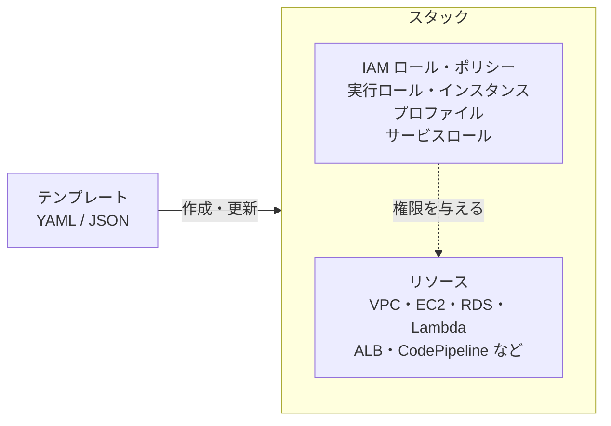

[目次へ戻る](README.md)

# 5. CloudFormation / IAM

この章の 2 つは、ほかの章のサービスを組み上げる土台にあたる。CloudFormation はリソースをコードで定義して構築し、IAM はそのリソースが何をしてよいかを決める。サービスを作るときは、それが使う IAM ロールとポリシーも同じテンプレートで一括して定義するのが普通なので、両者はまとめて扱う。



## CloudFormation

AWS のリソースを、テンプレート（YAML または JSON）に宣言的に書いて作成・更新・削除するサービス。Infrastructure as Code（IaC）の基盤。

ネットワーク（[2 章](02-vpc.md)）、サーバーとデータベース（[1 章](01-ec2-ecs-rds-s3.md)）、入口（[3 章](03-lambda-api-gateway-sns-sqs.md)・[4 章](04-cloudfront-alb-waf.md)）、CI/CD の仕組み（[6 章](06-cicd.md)）、そしてそれぞれに付く権限まで、AWS 上の構築のすべてに関わる。CodePipeline のデプロイ先として呼び出し、インフラの変更をパイプラインで流す使い方もあるが、それは使い方の一つにすぎず、場面は限られる。

**主な概念**

- **テンプレート**: 作りたいリソースを書いたファイル。主なセクションは `Parameters`（入力値）、`Resources`（リソース、必須）、`Outputs`（出力値）、`Conditions`、`Mappings`。
- **スタック**: テンプレートから作られたリソースのまとまり。スタック単位で更新・削除する。
- **変更セット**: 更新を適用する前に、何が追加・変更・置き換え・削除されるかを確かめる。
- **ロールバック**: 作成や更新が失敗すると、元の状態に自動で戻す。
- **ドリフト検出**: テンプレートの外で手作業で変更されたリソースを見つける。
- **スタック間の連携**: `Outputs` のエクスポートと `Fn::ImportValue`、入れ子スタック。
- **StackSets**: 複数のアカウント・リージョンに同じスタックを展開する。
- **関連ツール**: AWS CDK（TypeScript や Python などでインフラを書き、CloudFormation テンプレートを生成）、AWS SAM（サーバーレス向けの短い記法）。どちらも最終的には CloudFormation で動く。

```yaml
# 例: S3 バケットを 1 つ作るテンプレート
AWSTemplateFormatVersion: "2010-09-09"
Parameters:
  Env:
    Type: String
    AllowedValues: [dev, prod]
Resources:
  AssetsBucket:
    Type: AWS::S3::Bucket
    Properties:
      BucketName: !Sub "example-assets-${Env}"
      VersioningConfiguration:
        Status: Enabled
Outputs:
  BucketArn:
    Value: !GetAtt AssetsBucket.Arn
```

## IAM

AWS の操作について「誰が」「どのリソースに対して」「何をしてよいか」を管理するサービス（Identity and Access Management）。グローバルなサービスで、追加料金はかからない。ほかの章のサービスの操作も、CloudFormation によるスタックの操作も、IAM の許可がなければ行えない。

### 主体（プリンシパル）

| 主体 | 説明 | 主な使い道 |
| --- | --- | --- |
| ルートユーザー | アカウント作成時のメールアドレスで入る、すべての権限を持つユーザー | 日常の作業には使わない。MFA を設定して保管する |
| IAM ユーザー | 長期の認証情報（パスワード、アクセスキー）を持つ利用者 | 人の利用は IAM Identity Center に寄せ、IAM ユーザーは減らすのが推奨 |
| IAM グループ | ユーザーの集まり。グループにポリシーを付けて一括で権限を与える | 部署・役割ごとの権限管理 |
| IAM ロール | 一時的な認証情報で「引き受ける」権限の入れ物 | EC2・Lambda・CodeBuild などのサービス、別アカウント、外部 ID（SAML・OIDC）からの利用 |

**ロールの使われ方の例**

- **EC2**: インスタンスプロファイルとしてロールを付けると、アプリケーションが S3 などをアクセスキーなしで呼べる。
- **Lambda**: 実行ロールで、関数が触れてよいサービスを決める。
- **ECS**: タスクロールでアプリケーションの権限を、タスク実行ロールで ECS がイメージの取得やログの書き込みに使う権限を与える（[1 章](01-ec2-ecs-rds-s3.md)）。
- **CodeBuild / CodePipeline / CloudFormation**: サービスロールで、デプロイ時に作成・変更してよいリソースを決める。
- **GitHub Actions など外部の CI**: OIDC でロールを引き受け、長期のアクセスキーを置かずに済ませる。
- **クロスアカウント**: STS の `AssumeRole` で、別アカウントのロールを一時的に使う。

### ポリシー

権限を JSON で書いたもの。

```json
{
  "Version": "2012-10-17",
  "Statement": [
    {
      "Effect": "Allow",
      "Action": ["s3:GetObject", "s3:PutObject"],
      "Resource": "arn:aws:s3:::example-assets-prod/*",
      "Condition": {
        "Bool": { "aws:SecureTransport": "true" }
      }
    }
  ]
}
```

| 要素 | 意味 |
| --- | --- |
| `Effect` | `Allow`（許可）または `Deny`（拒否） |
| `Action` | 操作。`サービス名:操作名` の形 |
| `Resource` | 対象リソースの ARN |
| `Condition` | 適用する条件（送信元 IP、タグ、MFA の有無など） |
| `Principal` | 誰に対する許可か。リソースベースポリシーでのみ書く |

**ポリシーの種類**

| 種類 | 付ける先 | 役割 |
| --- | --- | --- |
| アイデンティティベースポリシー | ユーザー、グループ、ロール | 主体ができることを許可する。AWS 管理ポリシー、カスタマー管理ポリシー、インラインポリシーがある |
| リソースベースポリシー | S3 バケット、SQS キュー、Lambda 関数など | そのリソースに誰がアクセスできるかを決める |
| アクセス許可の境界 | ユーザー、ロール | 与えうる権限の上限を決める |
| サービスコントロールポリシー（SCP） | AWS Organizations のアカウント・OU | アカウント全体で使える権限の上限を決める |
| セッションポリシー | ロールを引き受けるときのセッション | そのセッションの権限をさらに絞る |

### 評価のしかた

1. 既定ではすべて**拒否**される。
2. どこかに**明示的な `Deny`** があれば、他に `Allow` があっても拒否される。
3. 適用されるポリシーのどこかに `Allow` があり、SCP・アクセス許可の境界などの上限の範囲内であれば許可される。

### 運用の原則

- **最小権限**: 必要な操作とリソースだけを許可する。IAM Access Analyzer で、外部に公開されているリソースや使われていない権限を見つけられる。
- **一時的な認証情報を使う**: アクセスキーを配らず、ロールと IAM Identity Center を使う。
- **MFA**: ルートユーザーと、人が使うすべてのアカウントに設定する。
- **記録**: 誰がいつ何をしたかは AWS CloudTrail に残る。

## CloudFormation で IAM を定義する

サービスのリソースと、そのサービスが使うロールを同じテンプレートに書く。ポリシーの `Resource` に同じテンプレート内のリソースを `!GetAtt` や `!Ref` で指定すれば、権限の対象がリソースと一緒に作られ、一緒に消える。手作業で付けた権限が残り続けることもない。

```yaml
# 例: S3 バケットと、そこを読むだけの Lambda 関数を、実行ロールごと定義する
Resources:
  ReportsBucket:
    Type: AWS::S3::Bucket

  ReaderRole:
    Type: AWS::IAM::Role
    Properties:
      AssumeRolePolicyDocument:          # 誰がこのロールを引き受けられるか（信頼ポリシー）
        Version: "2012-10-17"
        Statement:
          - Effect: Allow
            Principal:
              Service: lambda.amazonaws.com
            Action: sts:AssumeRole
      ManagedPolicyArns:
        - arn:aws:iam::aws:policy/service-role/AWSLambdaBasicExecutionRole   # ログ出力
      Policies:
        - PolicyName: read-reports
          PolicyDocument:
            Version: "2012-10-17"
            Statement:
              - Effect: Allow
                Action: s3:GetObject
                Resource: !Sub "${ReportsBucket.Arn}/*"   # このバケットだけに絞る

  ReaderFunction:
    Type: AWS::Lambda::Function
    Properties:
      Runtime: python3.12
      Handler: index.handler
      Role: !GetAtt ReaderRole.Arn
      Code:
        ZipFile: |
          def handler(event, context):
              return "ok"
```

**押さえておくこと**

- **CAPABILITY_IAM / CAPABILITY_NAMED_IAM**: IAM リソースを含むスタックを作るときは、この承認を明示的に渡す必要がある。ロール名などを固定で付けるなら `CAPABILITY_NAMED_IAM`。
- **ロール名は固定しない**: 名前を付けないと CloudFormation が一意の名前を自動で付ける。固定すると、同じテンプレートを別環境・別リージョンに展開したときに名前がぶつかる。
- **スタックを操作する権限**: 既定では、スタックを操作した人の権限でリソースが作られる。CloudFormation のサービスロールを指定すると、そのロールの権限で作られるので、操作する人には「スタックを操作する権限」だけを渡せばよくなる。
- **権限昇格に注意**: IAM ロールを作れる人は、自分より強いロールを作れてしまう。テンプレートで作るロールに付けられる上限を、アクセス許可の境界で決めておく方法がある。
- **SAM・CDK の場合**: SAM の `Policies`（ポリシーテンプレート）や CDK の `bucket.grantRead(fn)` のような書き方で、ロールとポリシーを自動で生成できる。生成される内容は CloudFormation テンプレートで確かめられる。

## スタックの分け方

すべてを 1 つのスタックに入れると、小さな変更でも全体が更新の対象になり、失敗したときの影響も大きい。変更の頻度と寿命が近いものごとにスタックを分け、下の層の `Outputs` を上の層が参照する形にするのが一般的。IAM ロールは、それを使うリソースと同じスタックに置く。

| 層の例 | 含めるもの | 変更の頻度 |
| --- | --- | --- |
| ネットワーク | VPC、サブネット、ルートテーブル、NAT ゲートウェイ | まれ |
| データ | RDS、S3 バケット | まれ（削除保護をかける） |
| アプリケーション | ALB、Auto Scaling グループ、Lambda、API Gateway、CloudFront、それらの実行ロール・インスタンスプロファイル | 多い |
| CI/CD | CodePipeline、CodeBuild、CodeDeploy、Image Builder のパイプライン、それらのサービスロール | ときどき |

RDS や S3 のようにデータを持つリソースは、スタックの削除や置き換えで消えないよう、`DeletionPolicy: Retain` やスタックの削除保護を設定しておく。

人が使う権限（IAM Identity Center の許可セットなど）や、複数のスタックで共有するロールは、アプリケーションのスタックとは別に管理する。
