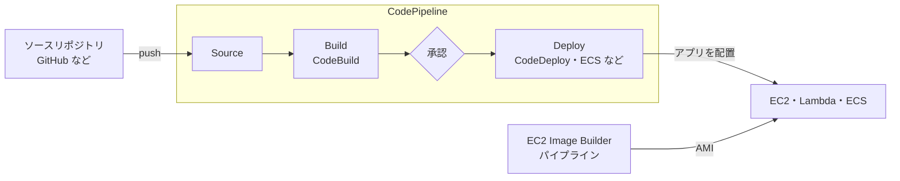

[目次へ戻る](README.md)

# 6. CodeBuild / CodeDeploy / CodePipeline / EC2 Image Builder

この章のサービスは、[5 章](05-cloudformation-iam.md)の CloudFormation で用意した環境の上で、アプリケーションのビルドとデプロイ、サーバーイメージの作成を繰り返し自動で行う。パイプラインやビルドプロジェクトの設定そのものも、CloudFormation で作る。



## CodeBuild

ソースコードのビルド、テスト、パッケージングを実行するマネージドなビルドサービス。ビルドサーバーを用意する必要がなく、使った時間だけ課金される。

**主な概念**

- **ビルドプロジェクト**: ソースの場所、ビルド環境（コンテナイメージ、コンピューティングのサイズ）、サービスロール、成果物の出力先を決める。
- **buildspec.yml**: リポジトリに置くビルド手順。`phases`（`install` → `pre_build` → `build` → `post_build`）、`artifacts`（成果物）、`cache`、`reports`（テスト結果）を書く。
- **ビルド環境**: AWS 提供の標準イメージか、ECR などの自作イメージ。Docker イメージをビルドすることもできる。
- **出力**: ログは CloudWatch Logs や S3 に、成果物は S3 や ECR に置く。

```yaml
# 例: buildspec.yml
version: 0.2
phases:
  install:
    runtime-versions:
      nodejs: 20
  build:
    commands:
      - npm ci
      - npm test
      - npm run build
artifacts:
  base-directory: dist
  files:
    - "**/*"
```

## CodeDeploy

ビルド済みのアプリケーションを、EC2（オンプレミスのサーバーを含む）、Lambda、ECS に配置するデプロイサービス。台数の多い環境でも、止めずに少しずつ入れ替え、失敗したら元に戻す。

**主な概念**

- **アプリケーションとデプロイグループ**: アプリケーションはデプロイ対象の名前の入れ物。デプロイグループは配置先の集まりで、EC2 ならタグや Auto Scaling グループで指定する。ALB を指定すると、入れ替え中のインスタンスを振り分けから外してくれる。
- **appspec.yml**: 成果物に含める配置の手順書。EC2 ではファイルのコピー先と、各段階で動かすスクリプトを書く。Lambda や ECS では切り替える版と、検証用の Lambda 関数を書く。
- **ライフサイクルフック（EC2）**: `ApplicationStop` → `BeforeInstall` → `AfterInstall` → `ApplicationStart` → `ValidateService` の順に、指定したスクリプトを実行する。
- **CodeDeploy エージェント**: EC2 で配置を行う常駐プログラム。インスタンスに入れておく（Lambda と ECS では不要）。
- **デプロイ方式**:

| 方式 | 内容 | 対象 |
| --- | --- | --- |
| インプレース | 今あるインスタンスの上でアプリを入れ替える | EC2 |
| ブルー/グリーン | 新しい環境を用意してから、通信を切り替える | EC2、Lambda、ECS |

- **デプロイ設定**: 一度に入れ替える範囲。EC2 では全台同時・半分ずつ・1 台ずつ。Lambda と ECS では、一部の通信だけ新しい版に流して様子を見るカナリア、一定の割合ずつ増やすリニアを選べる。
- **ロールバック**: デプロイの失敗や CloudWatch アラームをきっかけに、前の版へ自動で戻す。

```yaml
# 例: EC2 向けの appspec.yml
version: 0.0
os: linux
files:
  - source: /
    destination: /opt/app
hooks:
  ApplicationStop:
    - location: scripts/stop.sh
  AfterInstall:
    - location: scripts/install_deps.sh
  ApplicationStart:
    - location: scripts/start.sh
  ValidateService:
    - location: scripts/health_check.sh
      timeout: 300
```

## CodePipeline

ソースの変更からデプロイまでの流れ（パイプライン）を定義し、自動で順に実行する CI/CD のサービス。自分ではビルドやデプロイをせず、各段階を他のサービスに任せて取りまとめる。

**主な概念**

- **ステージとアクション**: パイプラインは複数のステージからなり、各ステージに 1 つ以上のアクションを置く。

| ステージの例 | アクションの提供元 |
| --- | --- |
| Source | GitHub / GitLab / Bitbucket（CodeConnections 経由）、S3、ECR |
| Build / Test | CodeBuild、Jenkins など |
| Approval | 手動承認（担当者が承認するまで止まる） |
| Deploy | CodeDeploy（EC2・Lambda）、ECS、S3、Elastic Beanstalk。インフラの変更もパイプラインで流す場合は CloudFormation |

- **アーティファクト**: ステージ間で受け渡す成果物。S3 のアーティファクトストアに置かれる。
- **パイプラインのタイプ**: V2 タイプではブランチやタグでの実行条件（トリガー）、パイプライン変数が使える。新しく作るなら V2 を選ぶ。

## EC2 Image Builder

EC2 の AMI（およびコンテナイメージ）の作成・テスト・配布を自動化するサービス。OS のパッチ適用やミドルウェアの導入を済ませた「ゴールデンイメージ」を定期的に作り直すのに使う。

**主な概念**

- **イメージレシピ**: ベースイメージ（親イメージ）と、適用するコンポーネントの組み合わせ。
- **コンポーネント**: イメージに加える処理を YAML で書いたもの。ビルド用（ソフトウェアの導入・設定）とテスト用がある。AWS 提供のもの（CloudWatch エージェントの導入、CIS ベンチマークでの強化など）も使える。
- **インフラストラクチャ設定**: ビルドに使う一時インスタンスのタイプ、サブネット、セキュリティグループ、IAM ロール（インスタンスプロファイル）。
- **ディストリビューション設定**: できた AMI をどのリージョン・アカウントに配るか。起動テンプレートの AMI を自動で差し替えることもできる。
- **イメージパイプライン**: 上の設定をまとめ、スケジュールやベースイメージの更新をきっかけに実行する。
- **ライフサイクルポリシー**: 古いイメージを自動で廃止・削除する。

## 4 つの関係

| サービス | 自動化するもの | 入力 | 出力 |
| --- | --- | --- | --- |
| CodeBuild | ビルドとテスト | ソースコード、buildspec | 成果物、テスト結果 |
| CodeDeploy | アプリケーションの配置と切り替え | 成果物、appspec | 新しい版が動くサーバー・関数・コンテナ |
| CodePipeline | ビルドからデプロイまでの順序と実行のきっかけ | ソースの変更 | デプロイされたアプリケーション |
| EC2 Image Builder | サーバーイメージの作成 | レシピ、コンポーネント | AMI、コンテナイメージ |
