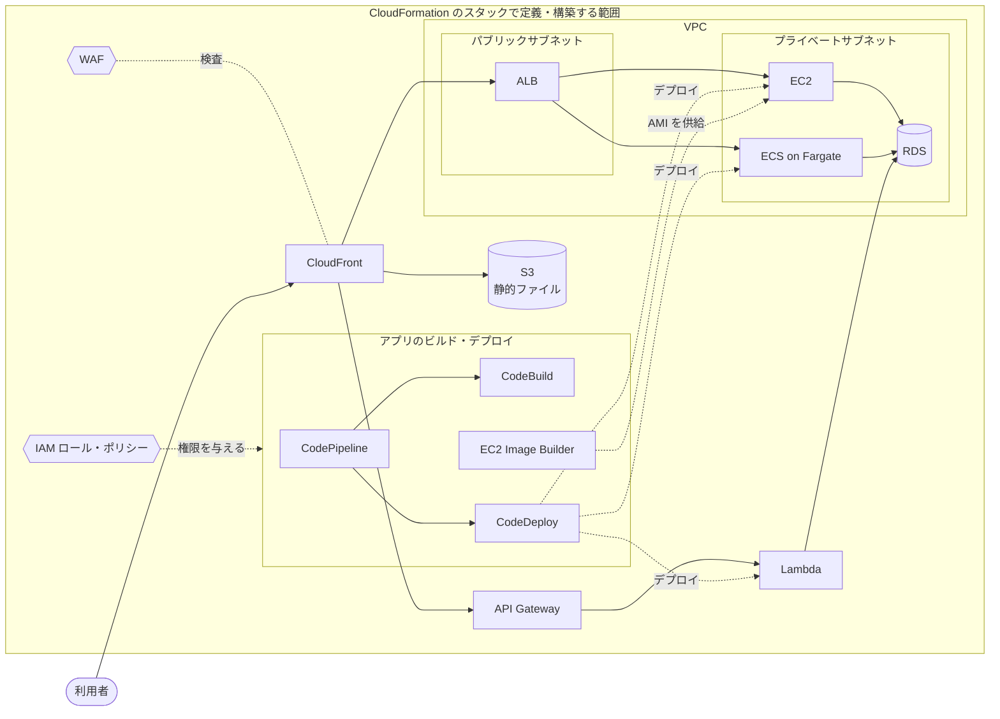

# AWS 構成要素の解説

Web システムを AWS 上に組むときによく使う構成要素を、6 つの章に分けて説明する。各章は「何をするサービスか」「押さえるべき概念」「他のサービスとのつながり」の順に書いている。

## 目次

| 章 | 役割 | サービス |
| --- | --- | --- |
| [1](01-ec2-ecs-rds-s3.md) | 処理を動かす・データを持つ | EC2 / ECS / Fargate / RDS / S3 |
| [2](02-vpc.md) | ネットワークの区画と通信の制御 | VPC / サブネット / セキュリティグループ |
| [3](03-lambda-api-gateway-sns-sqs.md) | サーバーを管理しない実行環境と、メッセージによる処理の切り離し | Lambda / API Gateway / SNS / SQS |
| [4](04-cloudfront-alb-waf.md) | 入口での配信・負荷分散・攻撃の遮断 | CloudFront / ALB / WAF |
| [5](05-cloudformation-iam.md) | インフラ全体をコードで構築する土台と、権限の管理 | CloudFormation / IAM |
| [6](06-cicd.md) | ビルド・デプロイ・イメージ作成の自動化 | CodeBuild / CodeDeploy / CodePipeline / EC2 Image Builder |

## 全体像

典型的な Web システムでは、各章のサービスが次のように組み合わさる。

CloudFormation は他のサービスと並ぶ部品ではない。図の外枠のとおり、ここに出てくるリソースのすべてを、CI/CD のパイプラインや IAM ロールも含めてコードで定義し、構築する土台にあたる。

## 章をまたいだつながり

| つながり | 内容 |
| --- | --- |
| 1 章 × 2 章 | EC2・ECS のタスク・RDS は VPC のサブネットに置き、セキュリティグループで通信を絞る。S3 は VPC の外にあり、VPC エンドポイントで私的につなげる |
| 1 章 × 4 章 | CloudFront は S3 を、ALB は EC2 や ECS のタスクを後ろに置く |
| 3 章 × 1・2 章 | Lambda は VPC に接続すれば RDS に届く。API Gateway は EC2 の API サーバーの代わりになる。SQS に溜めたメッセージは、Lambda のほか ECS のタスクや EC2 も処理できる |
| 4 章 × 2 章 | ALB はパブリックサブネットに置き、その SG からの通信だけをアプリに通す。SG が IP とポートで絞るのに対し、WAF はリクエストの内容で攻撃を止める |
| 4 章 × 3 章 | WAF は API Gateway の REST API にも付けられる。HTTP API には付けられないので、必要なら前に CloudFront を置く |
| 5 章 × 全章 | CloudFormation で、ほかのすべての章のリソースを、それぞれが使う IAM ロール・ポリシーと合わせてコードとして作る。6 章の CI/CD の仕組み自体もその対象。すべての操作は IAM で許可される |
| 6 章 × 1・3 章 | アプリのビルドは CodeBuild、配置は CodeDeploy、その流れの取りまとめは CodePipeline、EC2 の AMI は EC2 Image Builder が受け持つ |
