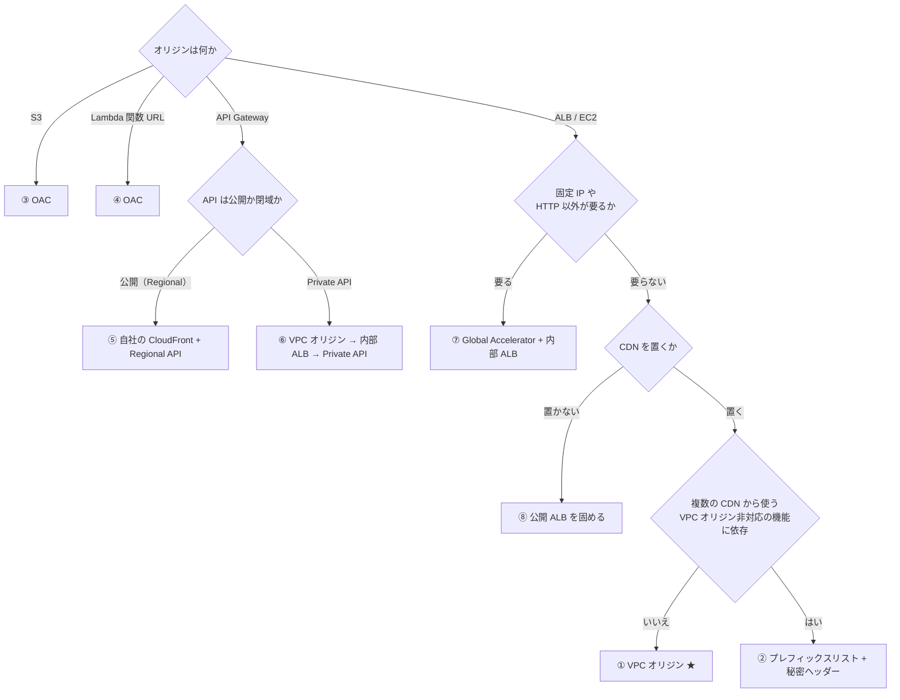
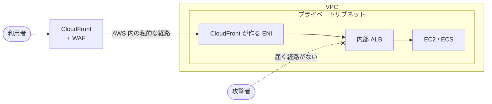
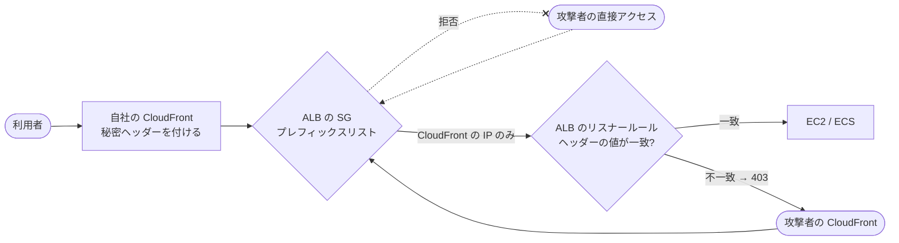
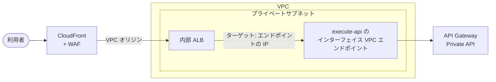

[目次へ戻る](README.md)

# オリジンを守る構成

CloudFront などの入口を置いても、裏側のオリジン（ALB、S3、Lambda、API Gateway）に**インターネットから直接届く経路**が残っていれば、WAF・キャッシュ・地理制限をすべて素通りされる。たとえば ALB のホスト名は、証明書の発行記録（Certificate Transparency ログ）や DNS から簡単に見つかる。CloudFront が付けるのと同じ `Host` ヘッダーを付けて ALB に直接送れば、CloudFront を通ったリクエストと見分けがつかない。

この文書では、オリジンの種類ごとに「誰がオリジンに届くか（経路）」をどう絞るかを、構成の候補として整理する。最後に、層の違う WAF をどこに置くかをまとめる。サービスそのものの説明は [4 章](04-cloudfront-alb-waf.md)・[3 章](03-lambda-api-gateway-sns-sqs.md)・[2 章](02-vpc.md) を参照。

## 一覧

| # | 構成 | オリジン | 直接アクセスの防ぎ方 | 位置付け |
| --- | --- | --- | --- | --- |
| ① | CloudFront + VPC オリジン（内部 ALB） | ALB / NLB / EC2（プライベート） | パブリック IP がなく、経路自体がない | **ALB の第一候補** |
| ② | CloudFront + 公開 ALB | ALB（パブリック） | マネージドプレフィックスリスト + 秘密ヘッダー | ① が使えないときの代替 |
| ③ | CloudFront + OAC | S3 | 署名付きリクエストとバケットポリシー | **S3 ならこれ一択** |
| ④ | CloudFront + Lambda 関数 URL（OAC） | Lambda 関数 URL | 署名付きリクエスト（`AWS_IAM` 認証）と関数のリソースポリシー | 関数 URL を公開するとき |
| ⑤ | 自社の CloudFront + Regional API Gateway | API Gateway（公開） | 秘密ヘッダーを API 側で検査 | 公開 API の推奨形 |
| ⑥ | CloudFront → VPC オリジン → 内部 ALB → Private API | API Gateway（プライベート） | 閉域のまま。ALB にも API にも公開経路がない | Private API を外に出すとき |
| ⑦ | Global Accelerator + 内部 ALB | ALB（プライベート） | パブリック IP がなく、経路自体がない | 固定 IP や TCP / UDP が要るとき |
| ⑧ | 公開 ALB で直接受ける（CloudFront なし） | ALB（パブリック） | 防がない。ALB 自体を固める | CDN を置かないとき |



## ① CloudFront + VPC オリジン（内部 ALB）★第一候補

プライベートサブネットにある ALB・NLB・EC2 を、CloudFront のオリジンとして直接使える機能。ALB にパブリック IP がないので、ホスト名を知られても、`Host` ヘッダーを付けても、インターネットから届く経路自体がない。VPC オリジンの利用に追加料金はかからない。



**作り方の要点**

- VPC にはインターネットゲートウェイが必要。トラフィックの経路には使われないが、「この VPC がインターネットからの通信を受ける」ことを示すために要る。ルートテーブルを変える必要はない。
- CloudFront は、プライベートサブネットにサービス管理の ENI を作って ALB に届く。サブネットに空きの IP アドレスが要る。
- ALB の SG のインバウンドでは、次のどちらかを許可する。
  - CloudFront が作るサービス管理の SG（`CloudFront-VPCOrigins-Service-SG`）。自分のアカウントの CloudFront からの通信だけに絞れるので、こちらがより厳しい。VPC オリジンを作ってからでないと指定できない。
  - CloudFront のマネージドプレフィックスリスト（`com.amazonaws.global.cloudfront.origin-facing`）。
- 既存の公開 ALB から移るときは、ステージングディストリビューション（継続的デプロイ）で VPC オリジンを試してから本番に昇格し、最後にサブネットをプライベートにする手順が案内されている。

**制約**

- gRPC は使えない。
- Lambda@Edge のオリジンリクエスト・オリジンレスポンスのトリガーは使えない。
- ネットワーク ACL のインバウンドのルールは、CloudFront から VPC オリジンへの通信には評価されない。一方、戻りの通信にはアウトバウンドのルールが評価される。エフェメラルポート（1024〜65535）を許可しておく。
- NLB をオリジンにするには、NLB に SG が付いている必要がある。TLS リスナーの NLB と Gateway Load Balancer はオリジンにできない。
- 東京リージョンでは、AZ `apne1-az3` が対象外。

## ② CloudFront + 公開 ALB（プレフィックスリスト + 秘密ヘッダー）※代替

ALB をパブリックサブネットに置いたまま、CloudFront 以外からのリクエストを ALB で弾く構成。① が登場する前の定番だった。この構成を選ぶのは、次のような場合に限られる。

- ALB を、CloudFront 以外の CDN を含む複数の入口から使う。
- VPC オリジンが使えない機能（gRPC、オリジン側の Lambda@Edge など）に依存している。

**2 段で絞る**

| 段 | 設定 | 防げること | これだけでは足りない理由 |
| --- | --- | --- | --- |
| 1. ネットワーク | ALB の SG で、CloudFront のマネージドプレフィックスリスト（`com.amazonaws.global.cloudfront.origin-facing`）からの HTTPS だけを許可 | CloudFront 以外の IP からの直接アクセス | 他人の CloudFront ディストリビューションも同じ IP 範囲から来る。攻撃者が自分の CloudFront を作ってオリジンに指定すれば SG を通る |
| 2. アプリケーション層 | CloudFront のオリジン設定で秘密の値のカスタムヘッダー（例: `X-Origin-Verify`）を付け、ALB のリスナールールでその値と一致するときだけ転送、それ以外は固定レスポンス 403 | 他人の CloudFront 経由のリクエスト | ヘッダーの値が漏れれば破られる |



**運用の注意**

- 秘密ヘッダーの値は Secrets Manager などに置き、定期的に替える。切り替えの間は、新旧どちらの値も ALB で受け付ける。
- ALB と CloudFront の間も HTTPS にして、ヘッダーの値が経路上で読めないようにする。
- プレフィックスリストは、1 つでも SG のルールを多く消費する。ほかのルールと合わせて SG のルール数の上限に収まるかを確かめる。
- ALB の側で、ヘッダーの検査の代わりに WAF の規則で同じ判定をしてもよい。

## ③ CloudFront + Origin Access Control（S3）

S3 をオリジンにするなら、Origin Access Control（OAC）一択。CloudFront が S3 へのリクエストに SigV4 で署名し、バケットポリシーでは「この CloudFront ディストリビューション（`AWS:SourceArn`）からのリクエストだけ」を許可する。バケット自体はパブリックアクセスをブロックしたままにする。

```json
{
  "Version": "2012-10-17",
  "Statement": [
    {
      "Effect": "Allow",
      "Principal": { "Service": "cloudfront.amazonaws.com" },
      "Action": "s3:GetObject",
      "Resource": "arn:aws:s3:::example-assets-prod/*",
      "Condition": {
        "StringEquals": {
          "AWS:SourceArn": "arn:aws:cloudfront::111122223333:distribution/EDFDVBD6EXAMPLE"
        }
      }
    }
  ]
}
```

以前の Origin Access Identity（OAI）はレガシー扱いで、次のものに対応していない。

- オプトインのリージョンを含む、すべてのリージョンの S3 バケット（2023 年 1 月以降にできたリージョンなど）
- AWS KMS による SSE-KMS で暗号化したオブジェクト
- S3 への動的なリクエスト（`PUT`、`POST`、`DELETE`）

**注意**

- S3 の静的ウェブサイトホスティングのエンドポイントをオリジンにすると、カスタムオリジン扱いになり、OAC も OAI も使えない。インデックスドキュメントやリダイレクトは CloudFront の側（デフォルトルートオブジェクトや CloudFront Functions）で実現し、通常のバケットのエンドポイントを使う。
- SSE-KMS のオブジェクトを配信するなら、KMS キーのポリシーでも CloudFront（同じ `AWS:SourceArn` の条件付き）に `kms:Decrypt` を許可する。
- OAC を使うときは、S3 のオブジェクト所有者を「バケット所有者の強制」（新しいバケットの既定）にする。

## ④ CloudFront + Lambda 関数 URL（OAC）

Lambda 関数 URL は、それ自体が公開のエンドポイントのまま。そのため OAC を付けないと、関数 URL を直接叩けてしまう。AWS Security Hub でも、コントロール CloudFront.16（Lambda 関数 URL のオリジンに OAC を使う）として検知の対象になっている。

**設定の要点**

- 関数 URL の認証タイプ（`AuthType`）を `AWS_IAM` にする。`NONE` のままだと誰でも呼べる。
- 関数のリソースベースポリシーで、`cloudfront.amazonaws.com` に `lambda:InvokeFunctionUrl` と `lambda:InvokeFunction` の両方を、`AWS:SourceArn`（自分のディストリビューション）の条件付きで許可する。
- CloudFront の OAC はオリジンタイプ `lambda`、署名は「常に署名」にし、オリジンのプロトコルは HTTPS のみにする。

**注意**: `PUT` や `POST` で本文を送る場合、Lambda は署名なしのペイロードを受け付けない。クライアントが本文の SHA-256 を計算して `x-amz-content-sha256` ヘッダーに入れて CloudFront に送る必要がある。ブラウザのフォームから素直に POST するような用途では手間がかかるので、その場合は ⑤ の API Gateway や ① の ALB を検討する。

## ⑤ 自社の CloudFront + Regional API Gateway（公開 API）

API Gateway の REST API には、AWS が管理する CloudFront を前に持つエッジ最適化エンドポイントもある。それでも AWS の DDoS 耐性のホワイトペーパーでは、Regional エンドポイントの前に**自社で管理する CloudFront** を置く形が推奨されている。WAF、キャッシュ、地理制限、ログを自分でコントロールできるからである。エッジ最適化の CloudFront は AWS の管理なので、これらを設定できない。

API Gateway は公開エンドポイントのままなので、CloudFront を迂回した直接アクセスは別途絞る。② と同じく秘密ヘッダーを使うのが一般的。

| API の種類 | ヘッダーを検査する場所 |
| --- | --- |
| REST API | API のステージに WAF を付け、ヘッダーの値が一致しないリクエストをブロックする |
| HTTP API | WAF を付けられない。Lambda オーソライザーで検査する |

あわせて、カスタムドメインを使うなら、既定の `execute-api` エンドポイントを無効にしておくと、推測しやすい URL での直接アクセスを減らせる（カスタムドメイン自体は公開のまま）。

## ⑥ CloudFront → VPC オリジン → 内部 ALB → Private API（閉域を維持）

API Gateway を Private API（VPC の中からしか呼べない API）のまま、CloudFront からインターネットに公開したい場合の構成。CloudFront から API Gateway の Private API には直接つなげないので、① の VPC オリジンで内部 ALB に入り、そこから Private API に渡す。



**設定の要点**

- `execute-api` のインターフェイス VPC エンドポイントを作り、その ENI の IP アドレスを、ALB の IP ターゲットグループに登録する。
- ALB から Private API へは HTTPS。API Gateway はリクエストの `Host` ヘッダーで呼び先の API を決めるので、Private API のカスタムドメイン名を使い、CloudFront・ALB・API の間でホスト名をそろえる。
- Private API のリソースポリシーで、この VPC エンドポイントからの呼び出しだけを許可する。
- ALB とエンドポイントのどちらにも公開経路がないので、閉域のまま入口を CloudFront に一本化できる。その分、構成要素が多く、費用もインターフェイスエンドポイントと ALB の分かかる（[コスト見積もり](cost-basics.md)）。

## ⑦ Global Accelerator + 内部 ALB（固定 Anycast IP / HTTP 以外も可）

AWS Global Accelerator は、世界共通の固定の Anycast IP アドレス（2 つ）でリクエストを受け、AWS のネットワークを通してリージョンのエンドポイントに届けるサービス。次の場合の選択肢になる。

- 取引先のファイアウォールで許可してもらうなど、**固定 IP** が必要。
- HTTP ではなく **TCP / UDP** を受けたい（その場合のエンドポイントは NLB や EC2）。

内部 ALB もエンドポイントにできるので、① と同じく ALB にパブリック IP を持たせずに済む。ALB のエンドポイントでは、クライアントの IP アドレスも保たれる。

**注意**

- Global Accelerator には WAF を付けられず、キャッシュもない。WAF は ALB に付ける。
- 固定の時間料金と、通常のデータ転送料金に上乗せされる料金がかかる（下の「コスト」）。

### 主な機能

- **固定の Anycast IP**
  - IPv4 では 2 つ、デュアルスタックでは IPv4 と IPv6 が 2 つずつ割り当てられる。
  - 同じ IP を世界中のエッジが受け持ち、利用者は最寄りのエッジに着く。そこから先は AWS のネットワークを通るので、一般のインターネットを経由するより遅延と揺らぎが小さい。
  - IP は、アクセラレーターを無効にしても保持される。削除すると失われる。
  - 自社の IP 範囲を持ち込むこと（BYOIP）もできる。
- **エンドポイント**（標準アクセラレーター）
  - ALB（内部 ALB を含む）、NLB、EC2 インスタンス、Elastic IP。
  - 複数のリージョンにまたがって登録できる。
- **ヘルスチェックと切り替え**
  - 異常なエンドポイントを自動で外し、正常なものに振り向ける。
  - DNS の切り替えと違い、TTL のキャッシュを待たない。
- **トラフィックダイヤルと重み**
  - リージョンごとの流量の割合と、エンドポイントごとの重みを変えられる。
  - 段階的なリリースや、リージョンからの退避に使う。
- **クライアント IP の保持**
  - ALB、EC2 インスタンス、SG 付きの NLB のエンドポイントで使える。
  - Elastic IP と、SG のない NLB のエンドポイントでは使えない。
- **カスタムルーティングアクセラレーター**: 特定の利用者を、VPC のサブネット内の特定の EC2・ポートに決めて送る（ゲームのマッチングなど）。普通は標準アクセラレーターを使う。

### CloudFront との違い

| 観点 | CloudFront | Global Accelerator |
| --- | --- | --- |
| 層 | HTTP(S)（L7） | TCP / UDP（L4） |
| キャッシュ | あり | なし（毎回リージョンまで届く） |
| WAF | 付けられる | 付けられない（後ろの ALB に付ける） |
| TLS の終端 | CloudFront（証明書は us-east-1 の ACM） | 後ろのエンドポイント（ALB や EC2 の証明書のまま） |
| IP | 変わる（DNS 名で使う） | 固定 |
| 向く用途 | Web 配信、静的ファイル、API | 固定 IP の要件、HTTP 以外、マルチリージョンの速い切り替え |

### コスト

| 項目 | 料金 |
| --- | --- |
| 固定料金 | 1 アクセラレーターあたり 0.025 USD / 時間（月 730 時間で約 18.25 USD）。1 時間未満も 1 時間で数え、無効にしていてもかかる |
| DT-Premium | 転送量 1 GB あたりの追加料金。1 時間ごとに、受信と送信の多い方の向きにだけかかる。単価はリージョンと利用者の地域の組み合わせで決まる |
| 通常のデータ転送料金 | EC2 などのデータ転送（アウト）は、DT-Premium とは別に通常どおりかかる |

アクセラレーターで使うパブリック IPv4 アドレスにも、通常の料金がかかるとされている。

**DT-Premium の主な単価（USD / GB）**

| リージョン（送り元）＼ 利用者の地域 | 北米 | 欧州 | アジア太平洋 | 韓国 | 豪州 |
| --- | ---: | ---: | ---: | ---: | ---: |
| アジア太平洋 | 0.012 | 0.043 | 0.010 | 0.058 | 0.080 |
| 北米 | 0.015 | 0.015 | 0.035 | 0.035 | 0.105 |
| 欧州 | 0.015 | 0.015 | 0.033 | 0.035 | 0.105 |

料金ページでは、日本は個別に載っていない。「アジア太平洋」から除かれているのはインド・フィリピン・タイ・韓国だけなので、日本はアジア太平洋に含まれると読んだ。正確には AWS の料金計算ツールで確かめる。

**試算**

前提は、東京リージョンのエンドポイントから国内の利用者に月 1 TB（1,000 GB）を送り出すこと。データ転送（アウト）は、東京のインターネット向けの最初の段階の単価で計算した。

| 項目 | 計算 | 月額 |
| --- | --- | ---: |
| 固定料金 | 0.025 × 730 | 18.25 USD |
| DT-Premium | 1,000 GB × 0.010 | 10.00 USD |
| データ転送（アウト） | 1,000 GB × 0.114 | 114.00 USD |
| 合計 | | 約 142 USD |

ALB を使うなら、その料金は別にかかる。

**費用の見方**

- **国内の利用者だけなら速さの効果は小さい**: 国内から東京リージョンへの経路はもともと短い。選ぶ理由は、固定 IP や TCP / UDP など機能の要件になる。
- **CloudFront より割高になりやすい**
  - CloudFront は、オリジンから CloudFront への転送が無料で、利用者への転送料金だけで済む。キャッシュが当たればオリジンの負荷も減る。
  - Global Accelerator は、通常の転送料金に DT-Premium と固定料金が上乗せされ、キャッシュもない。
- **地域をまたぐ利用者がいると効果が大きい**: 例えば東京リージョンに北米の利用者が来る場合。速さの改善が大きく、その分の DT-Premium（0.012 USD/GB）がかかる。
- **使わないアクセラレーターは削除する**: 無効にしても固定料金はかかる。ただし、削除すると固定 IP も失われる。

### EIP で公開している EC2 からの移行

EC2 を Elastic IP で直接公開し、Route 53 のドメイン名をその EIP に向けている構成から移る場合を考える。CloudFront に移すときと同じく、Global Accelerator でも **Route 53 のレコードの付け替えは必要**になる。利用者が接続する先が Global Accelerator の固定 IP に変わるためで、今の EIP をそのまま Global Accelerator の入口にはできない。

- レコードは、アクセラレーターへのエイリアスにする（ゾーンの頂点にも設定できる）。固定 IP 2 つを A レコードに書いてもよい。
- 例外は BYOIP。自社で持っている IP 範囲を使っていれば、IP を変えずに済む可能性がある。AWS が割り当てた普通の EIP なら、この方法は取れない。

**CloudFront に移す場合との違い**

| 観点 | CloudFront | Global Accelerator |
| --- | --- | --- |
| Route 53 | ディストリビューションへのエイリアスに変える | アクセラレーターへのエイリアス（または固定 IP の A レコード）に変える |
| 証明書 | us-east-1 の ACM に証明書を用意し、代替ドメイン名に登録する | 変更なし。TLS は今の EC2 上の証明書でそのまま終端する |
| オリジンの指定 | IP アドレスは指定できない。`origin.example.com` などの別名を EIP に向けて作る。CloudFront から EC2 への通信を HTTPS にするなら、その名前の証明書も EC2 に要る | EC2 インスタンス（または EIP）をエンドポイントに登録するだけ |
| アプリへの影響 | キャッシュや、転送するヘッダー・Cookie の設計が要る。送信元 IP は CloudFront の IP になり、利用者の IP は `X-Forwarded-For` などで渡る | ほぼなし。HTTP 以外のプロトコルもそのまま通る |

DNS の付け替えはどちらでも要る。そのうえで、証明書・オリジンの名前・アプリに手を入れずに移れるのは Global Accelerator の方。CloudFront を選ぶ利点は、キャッシュと、WAF をエッジで付けられること。

**移行の注意**

- **エンドポイントは「EC2 インスタンス」として登録する**: EIP のエンドポイントではクライアント IP を保持できない。インスタンスのエンドポイントなら送信元が利用者の IP のまま届くので、アクセスログや IP による制限が今までどおり動く。
- **セキュリティグループ**: クライアント IP を保持すると、届く通信の送信元は利用者の IP になる。インスタンスの SG では、今までどおり 443 などを広く許可しておく。
- **手順**
  1. 事前にレコードの TTL を短くしておく。
  2. アクセラレーターを作り、固定 IP で動くことを確かめてから、レコードを付け替える。
  3. DNS が浸透しきるまでは EIP 経由の通信も残る。どちらの経路も同じインスタンスに着くので、止めずに切り替えられる。
- **EIP 経由の直接アクセスが残る**
  - 付け替えたあとも EIP は公開されたままで、IP を知っていれば直接届く。この文書の冒頭で挙げた、迂回の問題と同じ。
  - 移行が済んだら、インスタンスをプライベートサブネットに移すか EIP を外して、Global Accelerator だけを入口にする。インスタンスのエンドポイントは、プライベートサブネットにあっても使える（VPC にインターネットゲートウェイは必要）。
- **入口を Global Accelerator だけに絞るとき**: WAF は Global Accelerator に付けられない。リクエストの中身の検査が要るなら、EC2 の前に ALB を置いて ALB に WAF を付ける。その場合は、この節の冒頭の「Global Accelerator + 内部 ALB」の形になる。

## ⑧ 公開 ALB で直接受ける（CloudFront なし）

攻撃者のリクエストも ALB までは届く前提で、ALB 自体を固める構成。CDN を置くほどではない社内向けや小規模なシステム、あるいはリージョン内の利用者しかいない場合に選ばれる。

**固め方**

- **WAF を ALB に付ける**: マネージドルール（共通の脆弱性、既知の悪い入力、IP の評判）とレートベースのルール。
- **SG**: 受けるのは 443 だけ。80 は HTTPS へのリダイレクト専用にする。
- **TLS**: リスナーのセキュリティポリシーで古い TLS を拒否する。
- **ALB の属性**: 不正なヘッダーフィールドの削除、HTTP desync の緩和モード（`defensive` 以上）を有効にする。
- **記録**: ALB のアクセスログと WAF のログを残す。
- **DDoS**: Shield Standard は自動で付く。重要なシステムなら Shield Advanced を検討する。

**弱点**: 攻撃のトラフィックも ALB が受けるので、ALB の LCU の料金やバックエンドの負荷として跳ね返る。エッジでのキャッシュや、エッジでの遮断の効果はない。

## WAF の位置付け

ここまでの ①〜⑧ は「誰がオリジンに届くか（経路）」の話だった。WAF は層が違い、「届いたリクエストの中身を検査する」もの。経路を絞っても、正規の入口（CloudFront など）を通ってくる攻撃は防げないので、両方が要る。

| 観点 | 経路の制御（①〜⑧） | WAF |
| --- | --- | --- |
| 問い | このリクエストは決められた入口を通ってきたか | このリクエストの中身は安全か |
| 手段 | パブリック IP を持たせない、SG、署名（OAC）、秘密ヘッダー | ルールによる検査（SQL インジェクション、XSS、ボット、レート制限、地理制限など） |
| 防げないこと | 正規の入口を通ってくる攻撃 | 入口を迂回した直接アクセス（迂回されれば WAF に届かない） |

**どこに付けるか**

| 構成 | WAF を付ける場所 | 補足 |
| --- | --- | --- |
| ①③④⑥ | CloudFront | オリジンへの別の経路がないので、CloudFront の WAF だけで足りる。CloudFront 用の Web ACL は us-east-1 で作る |
| ② | CloudFront（必要なら ALB にも） | ALB の WAF は、秘密ヘッダーの検査を WAF で行う場合や、多層にしたい場合に使う |
| ⑤ | CloudFront と、REST API のステージ | API 側は秘密ヘッダーの検査が主な役割 |
| ⑦⑧ | ALB | Global Accelerator には付けられない |

エッジ（CloudFront）で止めれば、攻撃のトラフィックがオリジンまで来ないので、オリジンの負荷と費用も減る。WAF そのものの説明と、付けられるリソースの一覧は [4 章](04-cloudfront-alb-waf.md#waf) を参照。
